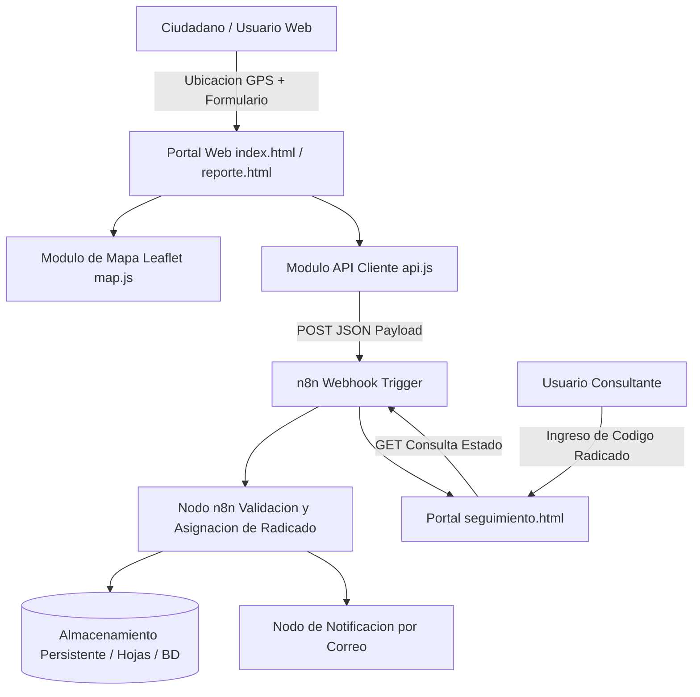

# GeoReport n8n - Plataforma de Reporte y Seguimiento Georreferenciado de Incidentes con Automatizacion n8n

Sistema integral para la captura, cartografia interactiva, gestion de radicados y notificacion automatizada de incidentes comunitarios e infraestructura urbana.

## Resumen Ejecutivo

La gestion eficiente de incidencias en espacios urbanos e instalaciones corporativas suele retrasarse debido a la ausencia de geolocalizacion precisa y a la falta de trazabilidad en tiempo real. GeoReport n8n resuelve este cuello de botella conectando una aplicacion web interactiva orientada a mapas con un motor de automatizacion de flujos de trabajo en n8n, permitiendo que cada reporte ciudadano sea radicado, clasificado y canalizado hacia los equipos de resolucion en cuestion de segundos.

## Alcance y Objetivos de Negocio

- Captura geoespacial asistida por GPS y geocodificacion inversa mediante OpenStreetMap y Leaflet.
- Orquestacion completa de logica transaccional en n8n a traves de Webhooks HTTP (`Workflow.json`).
- Generacion automatica de codigos unicos de radicado para consulta publica.
- Portal de seguimiento en tiempo real con indicador visual de avance (Radicado, En Evaluacion, Cuadrilla Asignada, Resuelto).
- Notificaciones automaticas multicanal (correo electronico, mensajeria o integracion con hojas de calculo).

## Arquitectura del Sistema

El sistema adopta una arquitectura desacoplada basada en eventos (EDA):
1. Capa de Frontend Modular en Vanilla JS (`js/app/*.js`):
   Encargada del manejo del mapa interactivo, captura de coordenadas y formularios de reporte.
2. Capa de Integracion REST y Webhooks (`api.js`, `config.js`):
   Despacha cargas utiles en formato JSON hacia el servicio de automatizacion.
3. Capa de Orquestacion y Logica en n8n (`Workflow.json`):
   Valida datos, asigna radicados, persiste registros y despacha alertas.
4. Capa de Consulta y Seguimiento (`seguimiento.html`, `reporte.html`):
   Permite a usuarios y administradores consultar el estado de cada solicitud.

### Diagrama de Flujo Arquitectonico

