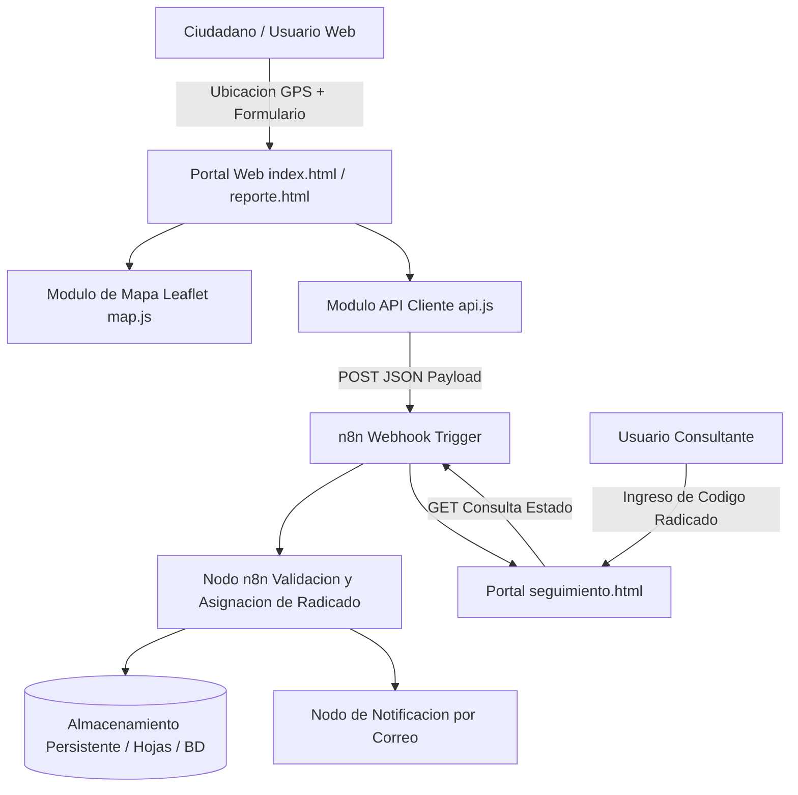

# GeoReport n8n - Plataforma de Reporte y Seguimiento Georreferenciado de Incidentes con Automatizacion n8n

Sistema integral para la captura, cartografia interactiva, gestion de radicados y notificacion automatizada de incidentes comunitarios e infraestructura urbana.

[]()
[]()
[]()
[]()
[]()

## Resumen Ejecutivo

La gestion eficiente de incidencias en espacios urbanos e instalaciones corporativas suele retrasarse debido a la ausencia de geolocalizacion precisa y a la falta de trazabilidad en tiempo real. GeoReport n8n resuelve este cuello de botella conectando una aplicacion web interactiva orientada a mapas con un motor de automatizacion de flujos de trabajo en n8n, permitiendo que cada reporte ciudadano sea radicado, clasificado y canalizado hacia los equipos de resolucion en cuestion de segundos.

## Alcance y Objetivos de Negocio

- Captura geoespacial asistida por GPS y geocodificacion inversa mediante OpenStreetMap y Leaflet.
- Orquestacion completa de logica transaccional en n8n a traves de Webhooks HTTP (`Workflow.json`).
- Generacion automatica de codigos unicos de radicado para consulta publica.
- Portal de seguimiento en tiempo real con indicador visual de avance (Radicado, En Evaluacion, Cuadrilla Asignada, Resuelto).
- Notificaciones automaticas multicanal (correo electronico, mensajeria o integracion con hojas de calculo).

## Arquitectura del Sistema

El sistema adopta una arquitectura desacoplada basada en eventos (EDA):
1. Capa de Frontend Modular en Vanilla JS (`js/app/*.js`):
   Encargada del manejo del mapa interactivo, captura de coordenadas y formularios de reporte.
2. Capa de Integracion REST y Webhooks (`api.js`, `config.js`):
   Despacha cargas utiles en formato JSON hacia el servicio de automatizacion.
3. Capa de Orquestacion y Logica en n8n (`Workflow.json`):
   Valida datos, asigna radicados, persiste registros y despacha alertas.
4. Capa de Consulta y Seguimiento (`seguimiento.html`, `reporte.html`):
   Permite a usuarios y administradores consultar el estado de cada solicitud.

### Diagrama de Flujo Arquitectonico



### Estructura de Directorios

```text
Proyecto-n8n/
├── Workflow.json            # Definicion declarativa exportable del flujo automatizado en n8n
├── index.html               # Pagina de inicio y bienvenida al centro de reporte
├── reporte.html             # Interfaz de captura de incidente con mapa interactivo
├── seguimiento.html         # Portal de consulta de estado por codigo de radicado
├── README.md                # Documentacion tecnica de ingenieria
├── css/
│   └── styles.css           # Diseno visual responsivo, estilos de mapa y tarjetas de estado
└── js/
    ├── app.js               # Coordinador general de la aplicacion
    ├── config.js            # Configuracion central de endpoints y webhooks n8n
    └── app/
        ├── api.js           # Cliente HTTP asincrono (Fetch API)
        ├── dom.js           # Manipulacion segura y reactiva de elementos del DOM
        ├── map.js           # Inicializacion y marcadores cartograficos con Leaflet
        ├── navigation.js    # Logica de enrutamiento y cambio de vistas
        ├── report.js        # Logica del formulario de radicación de incidentes
        ├── tracking.js      # Consulta y renderizado de la linea de tiempo de seguimiento
        └── utils.js         # Funciones auxiliares de formateo y validacion
```

## Stack Tecnologico

Construido combinando la flexibilidad de JavaScript del lado del cliente con el poder de orquestacion de n8n.

### Orquestacion Backend y Automatizacion

-  Motor de flujos de trabajo basado en nodos para integracion de servicios y datos.
-  Mecanismo asincrono de recepcion y respuesta de peticiones HTTP.
-  Formato de serializacion para envio de coordenadas e informacion de incidencias.

### Frontend, Cartografia y Visualizacion

-  Modulos independientes sin empaquetadores externos.
-  Proveedor de teselas geograficas y cartografia de codigo abierto.
-  Biblioteca ligera para mapas interactivos y marcadores arrastrables.
-  Formularios estructurados y soporte nativo de geolocalizacion.
-  Variables de diseno y componentes modernos adaptativos.

### Servicios y Proveedores Externos

- **OpenStreetMap Tile Layer**: Cartografia satelital y urbana de libre uso sin cuotas de facturacion.
- **Browser Geolocation API**: Solicitud de coordenadas directas mediante antena GPS del dispositivo movil o red Wi-Fi.
- **SMTP Email Service (n8n Node)**: Envio instantaneo de confirmacion de radicacion al usuario informante.

## Requisitos Previos del Sistema

- Instancia activa de n8n (instalacion local via Docker, npm o cuenta n8n Cloud):
  - Version minima recomendada: n8n 1.0+
- Navegador web moderno con soporte para HTTPS (requerido para permisos de geolocalizacion):
  - Google Chrome 85+
  - Firefox 80+
  - Safari 14+
- Servidor HTTP estatico para servir la interfaz web.

### Configuracion del Cliente Web (`js/config.js`)

El archivo `js/config.js` contiene los enlaces a los endpoints de n8n:

```javascript
export const CONFIG = {
  N8N_WEBHOOK_REPORT: "http://localhost:5678/webhook/crear-reporte",
  N8N_WEBHOOK_TRACKING: "http://localhost:5678/webhook/consultar-reporte",
  MAP_DEFAULT_CENTER: [7.1193, -73.1227], // Coordenadas iniciales (ej. Bucaramanga)
  MAP_DEFAULT_ZOOM: 14
};
```

## Guia de Instalacion y Despliegue Local

1. Clonar el repositorio:
```bash
git clone https://github.com/SantiSarmiento11/Proyecto-n8n.git
cd Proyecto-n8n
```

2. Levantar una instancia local de n8n mediante Docker:
```bash
docker run -it --rm --name n8n -p 5678:5678 -v ~/.n8n:/home/node/.n8n n8nio/n8n
```

### Importacion del Flujo en n8n

1. Abrir la consola de n8n en `http://localhost:5678`.
2. Seleccionar la opcion **Workflows** -> **Import from File**.
3. Seleccionar el archivo `Workflow.json` del repositorio.
4. Activar el flujo (toggle a estado **Active**) y copiar las URLs de Webhook de produccion en `js/config.js`.

### Ejecucion del Cliente Web

Servir los archivos de la interfaz mediante un servidor HTTP local:
```bash
# Ejecutar desde la raiz del proyecto:
python -m http.server 3000
```

Acceder a la aplicacion en: `http://localhost:3000`

## Funcionamiento del Sistema

El ciclo operativo contempla dos grandes caminos de usuario:
1. **Radicacion de Incidente**:
   - El usuario abre `reporte.html` y concede permisos de geolocalizacion.
   - El mapa posiciona un marcador en su ubicacion y permite arrastrarlo para mayor precision.
   - Diligencia titulo, categoria (vias, iluminacion, acueducto, aseo), descripcion y datos de contacto.
   - Al enviar, se despacha la peticion HTTP a n8n, la cual retorna un codigo radicado (ej. `RAD-2026-9481`).
2. **Seguimiento y Consulta**:
   - El usuario ingresa a `seguimiento.html`, escribe su radicado y visualiza la linea de tiempo de atencion.

### Vistas y Navegacion

- `index.html`: Pagina de bienvenida con acceso rapido a Reportar o Rastrear incidente.
- `reporte.html`: Formulario con mapa interactivo y campos con validacion en tiempo real.
- `seguimiento.html`: Barra de busqueda con renderizado dinamico del estado del ticket y mapa con el punto reportado.

### Estructura de la Carga Util (Payload JSON)

Cuerpo de la peticion enviada al Webhook de n8n:
```json
{
  "titulo": "Falla en alumbrado publico",
  "categoria": "Iluminacion",
  "descripcion": "Luminaria intermitente en la esquina del parque principal",
  "latitud": 7.119345,
  "longitud": -73.122781,
  "informante": {
    "nombre": "Santiago Sarmiento",
    "correo": "ciudadano@ejemplo.com"
  },
  "fechaReporte": "2026-11-11T12:00:00Z"
}
```

### Contratos de Endpoints n8n

| Endpoint | Metodo | Parametros Entrada | Respuesta Exitosa |
| :--- | :--- | :--- | :--- |
| `/webhook/crear-reporte` | `POST` | Objeto JSON con detalles e informe | `{"status": "success", "radicado": "RAD-2026-001"}` |
| `/webhook/consultar-reporte` | `GET` | Query param `?radicado=RAD-...` | `{"radicado": "...", "estado": "En Proceso", ...}` |

### Resiliencia ante Fallos de Red

- `api.js` implementa tiempos limite (timeouts) de conexion de 10 segundos.
- Si n8n no responde o se encuentra apagado, la interfaz muestra un mensaje claro al usuario:
  *"No fue posible conectar con el centro de recepcion de incidentes. Por favor verifique su conexion o intente nuevamente."*

## Estrategia de Pruebas y Aseguramiento de Calidad

- Verificacion de ejecucion de Webhooks mediante pruebas con cURL y Postman.
- Comprobacion de precision de marcadores en dispositivos moviles reales.
- Validacion de flujos de n8n en modo de prueba (Execute Node by Node).

### Prueba Rapida del Webhook mediante cURL

```bash
curl -X POST http://localhost:5678/webhook/crear-reporte \
  -H "Content-Type: application/json" \
  -d '{"titulo": "Prueba de integracion", "categoria": "Vias", "latitud": 7.12, "longitud": -73.12}'
```

## Registro de Ejecuciones en n8n

Cada ejecucion se almacena en la base de datos de auditoria de n8n (`Executions`), permitiendo inspeccionar la entrada, salida y tiempo de procesamiento exacto de cada nodo para analisis forense y monitoreo continuo.
